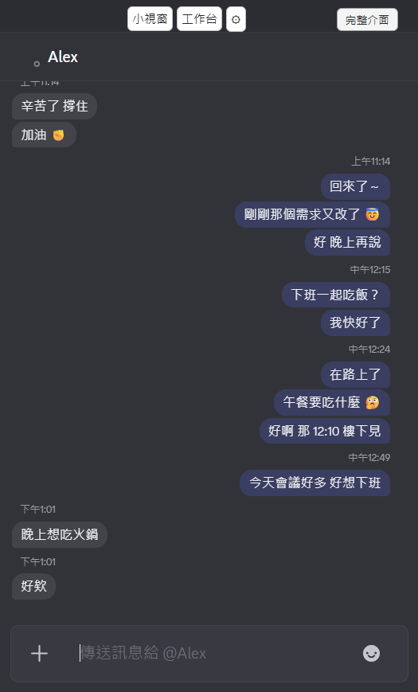

# Discord Mini DM

示意圖中的名稱與對話為假資料

把 Discord 網頁版的私訊變成上班用的極簡聊天小視窗（Chrome 擴充功能，Manifest V3）。

## 功能

- 左右氣泡：自己靠右、對方靠左，回覆引用與附件跟著作者對齊
- 獨立小視窗開啟 DM，記住視窗位置與大小
- 點擴充功能圖示快速開啟目前或上次的 DM
- 聊天對象自訂暱稱（僅本機顯示）
- 文字大小調整
- 三種外觀模式：跟隨 Discord／極簡淺色／自訂顏色
- 緊湊模式
- 工作台：下班倒數、常用連結、私人筆記

## 安裝

1. 下載或 clone 本 repo。
2. 開啟 `chrome://extensions`，打開右上角「開發人員模式」。
3. 點「載入未封裝項目」，選擇本資料夾。
4. 重新整理 Discord 分頁。

擴充功能 ID 已用 `manifest.json` 的 `key` 固定，搬移資料夾後設定不會遺失。

## 使用

- **第一次使用請確認「我的顯示名稱」**：點右上角 ⚙，最上方欄位留空時會自動偵測（提示文字顯示偵測結果）；不正確或偵測不到時請手動填入。未設定時維持 Discord 原生排版，⚙ 會出現紅點提醒。
- **Alt+Shift+M**：切換極簡模式與完整介面。
- **點擴充功能圖示**：以小視窗開啟 DM。

## 隱私

不使用 Discord token、不呼叫 Discord API、不讀取或外傳聊天內容；所有設定只存在本機（`chrome.storage.local`）。

## 已知限制

依賴 Discord 前端的 class 名稱，Discord 改版後可能失效，需要更新選擇器。

## 免責聲明

本專案並非 Discord 官方產品。修改 Discord 用戶端介面可能違反 Discord 服務條款，使用風險自負。
